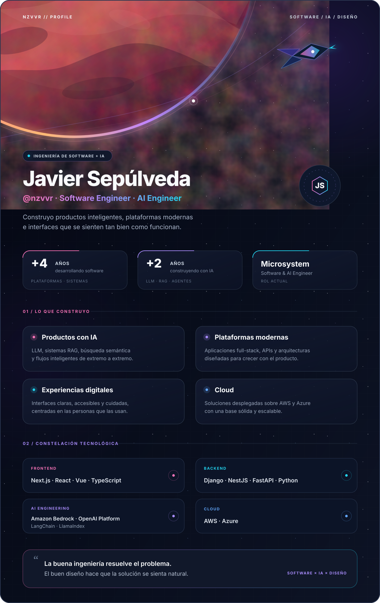

  

 

## Hola, soy Javier

Soy **Software Engineer y AI Engineer en Microsystem**. Llevo más de **4 años** desarrollando plataformas y sistemas modernos, y más de **2 años** construyendo soluciones basadas en inteligencia artificial.

Me interesa todo el recorrido de un producto: entender el problema, diseñar una experiencia clara y convertirla en software sólido, escalable y agradable de usar.

## En qué trabajo

- **Productos con IA** — integración de LLM, sistemas RAG, búsqueda semántica y flujos inteligentes.
- **Plataformas modernas** — aplicaciones full-stack, APIs y arquitecturas preparadas para crecer.
- **Experiencias digitales** — interfaces limpias, accesibles y centradas en las personas.
- **Cloud** — soluciones desplegadas sobre AWS y Azure.

## Stack

| Área | Tecnologías |
| :--- | :--- |
| **Frontend** | `Next.js` · `React` · `Vue` · `TypeScript` |
| **Backend** | `Django` · `NestJS` · `FastAPI` · `Python` |
| **AI Engineering** | `Amazon Bedrock` · `OpenAI Platform` · `LangChain` · `LlamaIndex` |
| **Cloud** | `AWS` · `Azure` |

## Cómo pienso el trabajo

> La buena ingeniería resuelve el problema. El buen diseño hace que la solución se sienta natural.

Busco ese punto de encuentro entre **software**, **inteligencia artificial** y **diseño**: productos técnicamente sólidos que también se entiendan, se disfruten y se vean bien.

## Conectemos

[LinkedIn](https://www.linkedin.com/in/jvism/) · [Correo](mailto:jsepulveda@nzw.cl) · **Sitio web próximamente**

Este perfil también será el hogar de mi próximo sitio personal.
